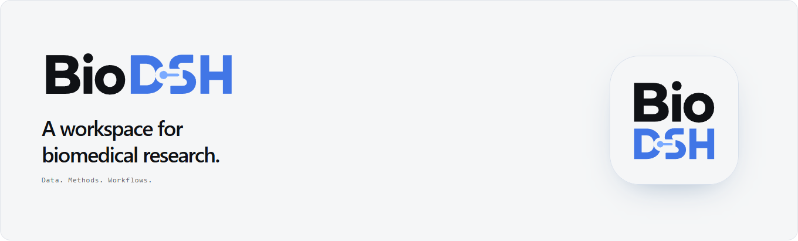
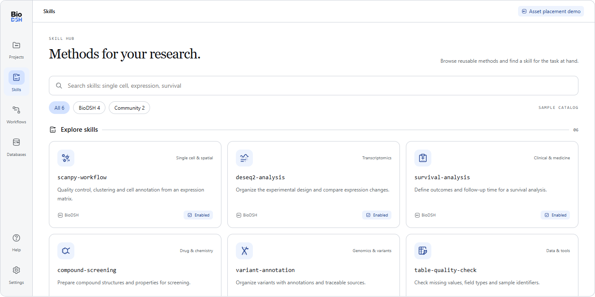

<div align="center">

<a href="http://43.167.193.205/"><picture><source media="(prefers-color-scheme: dark)" srcset="docs/brand/png/readme-banner-dark.png"></picture></a>

**A bioinformatics agent for clinicians and wet-lab scientists. Describe the analysis in plain language and get the result, with no coding.**

[中文](README.zh.md) · [Download](#download) · [dsh plugin](#use-it-inside-deepseek-harness) · [Results](#results)

[](https://github.com/sagirimo/BioDSH/releases)
[](https://www.npmjs.com/package/dsh-biodsh)
[](LICENSE)

</div>

You add your data (single-cell `h5ad`, count matrices, clinical tables, gene lists…) and ask a question such as *"Do responders and non-responders differ in CD8A expression?"* The agent loads the data, picks the right method, writes and runs the code, and reports the conclusion along with the figures, the tables and every step it took.

BioDSH runs on your own computer and is built on [DeepSeek Harness (dsh)](https://github.com/deepseek-ai/deepseek-harness). It comes in two forms: a one-click **desktop app** and a **dsh plugin** (`dsh-biodsh`).

<picture>
  <source media="(prefers-color-scheme: dark)" srcset="docs/brand-showcase/skills-dark-en.png">
  
</picture>

<sub>BioDSH 1.0 skill hub (preview; catalog entries and counts are illustrative). [Interactive preview](http://43.167.193.205/brand/?lang=en)</sub>

## Why BioDSH

- **Plain language in, conclusions out.** You don't need to write code or set up an environment. A Python analysis environment (scanpy, anndata, pandas, statsmodels, matplotlib…) installs itself on first launch.
- **Validated methods instead of improvised code.** It ships 17 official analysis skills: single-cell QC, clustering, annotation and treatment response; bulk RNA-seq with limma-voom; Kaplan–Meier and Cox survival; regression with robust standard errors; ANOVA designs; and more. The statistics skills were checked against R on tens of thousands of cases (for example, 101,587 survival comparisons with zero mismatches).
- **The right skill picked automatically.** For each request, a model selects the one or two relevant skills from the 17 official skills and a library of 2,000+ community skills, and loads only those, so the context stays small. Community skills are scanned, and those that ship benchmark answers are excluded.
- **Frontier-level accuracy from an inexpensive model.** With DeepSeek V4 Flash, BioDSH matches Claude Code driven by Opus on our 120-task benchmark (102 vs 103) at about a third of the API-equivalent cost (see [Results](#results)).
- **Long analyses always finish.** A convergence guard keeps the agent from running in circles. It first asks the agent to wrap up, then asks for a final answer, so you always get a result.
- **Your data stays safe.** Original files are never modified, and every analysis writes into a new folder. In offline mode BioDSH talks only to a model on your own machine or intranet, which suits hospitals and labs.
- **Every result can be traced.** Every step goes into an append-only session log that you can review, export or hand to a reviewer.
- **Reusable workflows.** You can save a finished analysis as a workflow and rerun it on new data. BioDSH can also build a workflow from an existing script, notebook or methods paragraph.
- **Your choice of model.** BioDSH works with DeepSeek's official API, any OpenAI-compatible endpoint, or a local or intranet model, and you can configure several of them side by side.

## Download

| Version | Platform | Get it |
| --- | --- | --- |
| **1.0.0** (latest) | Windows 10/11 | [`BioDSH_1.0.0_x64-setup.exe`](https://github.com/sagirimo/BioDSH/releases/latest) |
| **1.0.0** (latest) | macOS 12+ (Apple silicon) | [`BioDSH_1.0.0_aarch64.dmg`](https://github.com/sagirimo/BioDSH/releases/latest) |

- **Upgrading from 0.3.0:** installed 0.3.0 apps are not auto-updated to 1.0; install 1.0.0 over it when you are ready. Your projects, files and conversations are never deleted, but conversations recorded with 0.3.0 may not open in 1.0.
- **Windows:** on first run, click *More info → Run anyway*. The installer is not code-signed.
- **macOS:** the app is not notarized, so macOS may report it as "damaged". Move it to Applications and run `sudo xattr -cr /Applications/BioDSH.app` once.

The stable app checks for updates in the background and installs them with one click. Updates are signature-verified, and the app sends no data when it checks.

## Use it inside DeepSeek Harness

If you already use dsh, you can install the BioDSH agent as a plugin without the desktop app:

```bash
dsh plugin --profile web add dsh-biodsh
```

You can also install it from the dsh web UI: **Plugins → Install → `dsh-biodsh`**. Restart dsh, then pick **BioDSH** in the agent preset menu. Your other presets are left unchanged. The plugin requires dsh 0.2.1+ and pnpm. For details, see [`packages/dsh-biodsh`](packages/dsh-biodsh).

If you only want the skills, the official skills are plain dsh `SKILL.md` folders. `./scripts/install-into-dsh.sh <your-project>/.agents/skills` copies them in (use `install-into-dsh.ps1` on Windows).

## Results

From our preprint (*arXiv link coming*). The benchmark is BioDSH-Bench-120: 120 analysis tasks in 10 subdomains, graded by replaying each submitted script against a public table contract, with no LLM judge. Every agent runs in the same read-isolated sandbox, one run per configuration.

**Same model, different agent: a tie.** With every agent on DeepSeek V4 Flash:

| Agent (DeepSeek V4 Flash) | Correct / 120 |
| --- | --- |
| BioDSH + blind second analysis | 102 |
| DeepSeek Harness without BioDSH | 101 |
| BioDSH | 98 |
| Codex CLI | 98 |
| Claude Code | 96 |

No pairwise difference is statistically significant.

**The model matters more than the agent.** With their own models, Codex ranges from 76 to 116 and Claude Code from 95 to 103. On BixBench-Verified-50, run behind a network allow-list, all four agents score 33–34/50.

What BioDSH adds is therefore not accuracy on the same model but the environment around it: a desktop app, vetted skills, isolated and auditable runs, and a choice of local or remote models.

**A note on benchmark contamination.** Coding agents read whatever files they can reach and look answers up online, and several widely shared community skills ship benchmark answers. BioDSH's skill library is scanned for this, and the contaminated skills we found are excluded (`dsh-biodsh` 1.0.0-preview.2 and later).

## Build from source

You need Node.js 22+, stable Rust and the [Tauri prerequisites](https://tauri.app/start/prerequisites/).

```bash
cd desktop
npm ci
node scripts/stage-dsh.mjs     # dsh runtime + the dsh-biodsh bundle
node scripts/sync-skills.mjs   # official skills → resources
npm run tauri dev              # or: npm run tauri build
```

| Path | Contents |
| --- | --- |
| `desktop/` | The desktop app: React UI (`src/`), Rust backend (`src-tauri/`) and build scripts. |
| `packages/dsh-biodsh/` | The `dsh-biodsh` plugin: BioDSH presets, skill selection and the convergence guard. |
| `biodsh-core/skills/` | Official skills. |

## License

[MIT](LICENSE) for BioDSH's own code. Bundled components (DeepSeek Harness, community skills, Python packages) keep their own licenses.

BioDSH is an independent project built on [DeepSeek Harness](https://github.com/deepseek-ai/deepseek-harness). It is not affiliated with or endorsed by DeepSeek.
